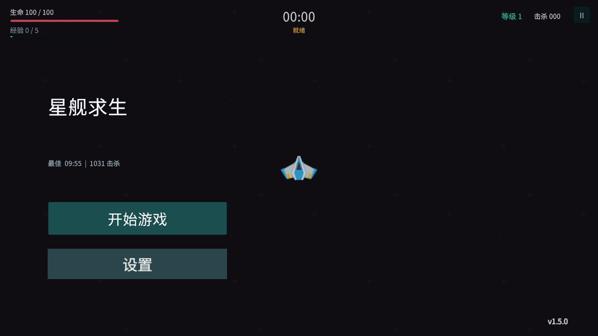
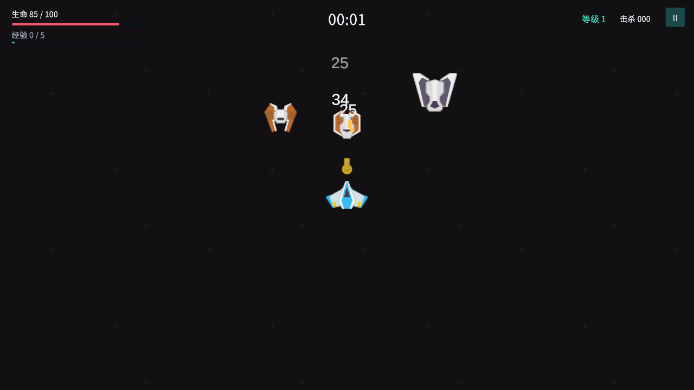
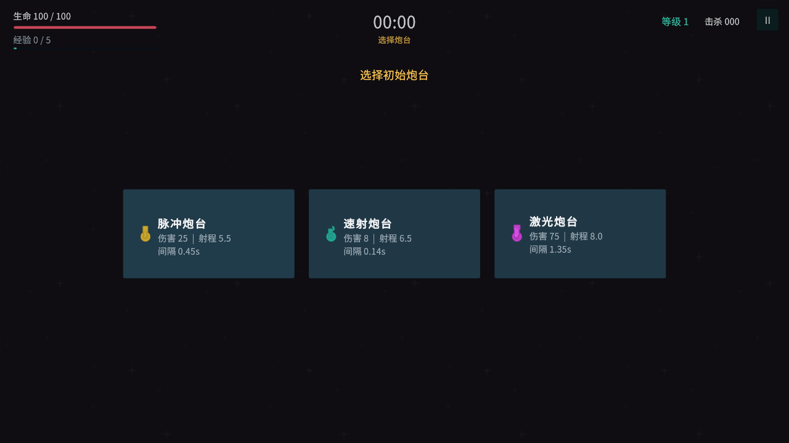
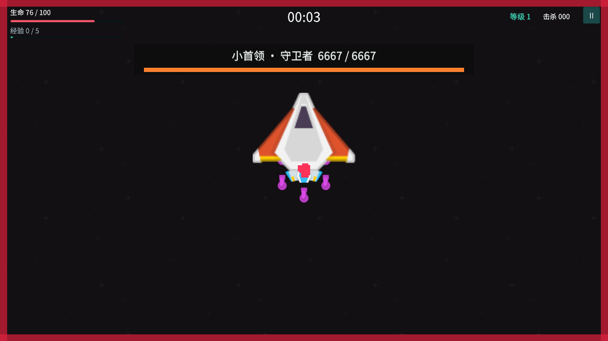
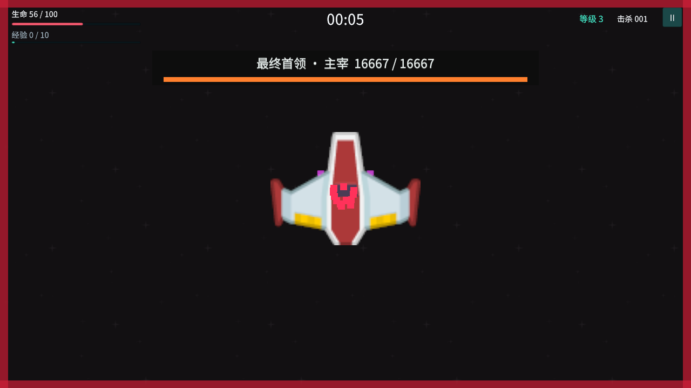

# v1.5.0 Release Evidence

`v1.5.0` is the current Starship Survival release. This version completes the space-fleet visual pass while retaining the intelligent boss and bounded combat-director systems introduced during the v1.4 iteration.

## Verification

- Release boundary checks: `31/31 PASS`
- PlayMode tests: `25/25 PASS`
- Windows release build: `0 errors / 0 warnings`
- Android release build: `0 errors / 0 warnings`
- Windows independent Player smoke test: title, normal combat, six-turret loadout, Warden fight and Overlord fight checked
- Android physical-device basic gameplay acceptance: passed by the author
- The title capture was regenerated from the final v1.5.0 Windows release package; the obsolete center cross and tactical grid are not present

## Runtime Captures

| Title | Normal combat | Six-turret loadout |
|---|---|---|
|  |  |  |

| Warden command ship | Overlord flagship |
|---|---|
|  |  |

## Evidence Boundary

Automated tests prove the checked rules and build boundaries, not commercial balance or compatibility with every Android device. Profiler captures from earlier iterations remain historical engineering evidence and are not used to claim a fixed percentage performance gain.

The complete build and release record is in [the v1.5.0 verification log](../../devlogs/25-v1.5.0-space-art-build-verification.md).
